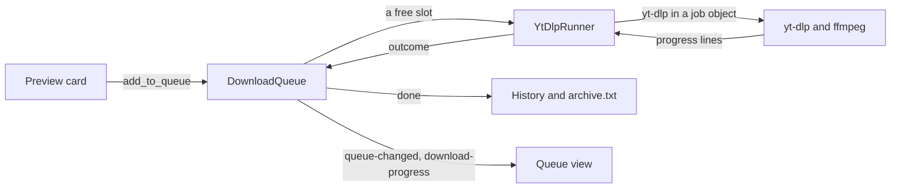
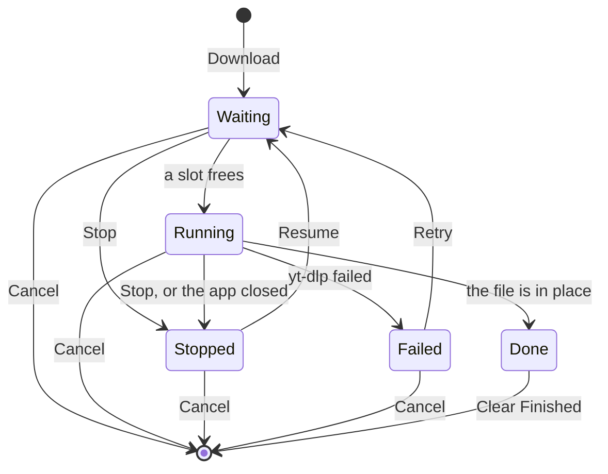

# Download Pipeline

> [!abstract]
> How a video goes from the preview card's Download to a file in its folder and a row in the history: the queue, the yt-dlp process and its arguments, progress, temporary folders, and what Stop, Resume, Cancel and Retry do. The code is in `tsundoku/core/src/downloads/`.

## Overview



1. Download on the preview card adds the video to the queue with a copy of the preset, so editing the preset later doesn't change it. A video can't be in the queue twice until it's done.
2. The queue starts waiting items while fewer than `downloads.atOnce` (2) run, in the order they were added.
3. Each run is a thread running yt-dlp to its end. Its progress reaches the UI as events; its output goes to the item's log.
4. When yt-dlp finishes, the file is recorded in the history (a `videos` row if it's new, and a `downloads` row) and `archive.txt` is rewritten. The item is Done.

## States



- The queue is saved in `tsundoku.db` (`queue_items`). An item that was running when the app closed or crashed comes back Stopped; waiting ones start again.
- Stop and Cancel both end the process (the whole job object, ffmpeg included). The run's thread then settles the item: Stop leaves it Stopped with its partial files; Cancel deletes its temporary folder and removes it.
- Retry and Resume put the item back in line. yt-dlp continues `.part` files by default, so neither starts over.

## Arguments

`runner.rs` builds the command, Tsundoku's arguments first so the preset's can change them:

| Arguments | Why |
| --- | --- |
| `--ignore-config --no-playlist` | A user's yt-dlp config can't interfere; a `watch?v=…&list=…` link downloads only the video |
| `--encoding utf-8 --newline --progress --progress-delta 0.5` | Readable output, one progress line at most every half second |
| `--progress-template download:…` and `postprocess:…` | Progress as JSON lines Tsundoku can read (see Progress) |
| `--print-to-file after_move:%(.{filepath,height,vcodec,acodec,ext})j <file>` | The final path and format, once the file is in place |
| `-P home:<folder> -P temp:<folder>\.tsundoku-<id>` | Where the file goes, and where yt-dlp works |
| `--ffmpeg-location`, `--js-runtimes deno:<path>` (or `--no-js-runtimes`) | Tsundoku's tools |
| `--force-overwrites` | Only for Download Again with the same preset, after the user confirms |
| The preset's (`Preset::to_args`) | Formats, conversion, file name, embedding, SponsorBlock, extra arguments |
| `-- <link>` | After `--`, the link can't be read as an option |

`--print-to-file` rather than `--print`: `--print` turns yt-dlp quiet, and its normal output is what the log keeps. `after_move` still reports the path when yt-dlp finds the file already there and skips the download, so such a file is recorded too.

### Presets

| Preset | Formats |
| --- | --- |
| Best Video | `-f bv*+ba/b --merge-output-format mkv --remux-video mkv` |
| 1080p MP4 | `-f bv*+ba/b -S res:1080,vcodec:h264,acodec:aac --merge-output-format mp4 --remux-video mp4` |
| Best Audio | `-f ba/b -x` |
| Audio MP3 | `-f ba/b -x --audio-format mp3 --audio-quality 0` |

> [!info]
> MP4 presets sort for H.264 and AAC rather than for MP4 files: YouTube also serves AV1 in MP4, which older devices can't play. Sorting by height first keeps the tallest video within the limit; the codec only decides between formats of that height.

Extra arguments that would break what Tsundoku relies on are refused when the preset is saved (`--yes-playlist`, `--download-archive`, `--print`, `--progress-template`, `-o`, `-P`, `--quiet` and a few more), abbreviations included, since yt-dlp accepts `--outp` for `--output`.

## Progress

yt-dlp prints a line starting with `@@tsundoku` and a space for every progress update; everything else goes to the log.

```text
@@tsundoku {"stage":"download","progress":{"status":"downloading","downloaded_bytes":1024,"total_bytes":223779,...},"vcodec":"av01.0.00M.08","acodec":"none"}
@@tsundoku {"stage":"postprocess","progress":{"status":"started","postprocessor":"Merger"}}
```

- Download lines carry the format's codecs: no video codec means Downloading Audio, no audio codec Downloading Video, both a single-file Downloading. Some sites (archive.org) give no codec, which reads as Downloading.
- Postprocessor names map to stages: Merger → Merging; ExtractAudio, VideoConvertor and VideoRemuxer → Converting; Metadata, EmbedThumbnail and EmbedSubtitle → Embedding; MoveFiles → Finishing; anything else → Processing.
- Only the fields Tsundoku reads are printed (`%(progress.{…})j`), so each line stays short.

## Temporary Folders

- Each item works in `<destination>\.tsundoku-<id>\`: on the same drive as the destination, so yt-dlp's final move is a rename, not a copy of a large file. The ID never repeats (`AUTOINCREMENT`).
- Stop keeps the folder, so Resume continues; Cancel deletes it; success deletes it once the file has moved out.
- A folder that can't be deleted (a file open in another app) is left behind rather than failing the download.

## Processes

Every yt-dlp run goes through `core::process`: no console window, started suspended, put in a job object that kills everything in it when its handle closes, then resumed. Ending the job ends yt-dlp and the ffmpeg it started, so cancelling during a merge leaves nothing running and nothing locking the file, and closing or crashing the app does the same.

## Logs

- `logs\<id>.log` in the data folder: a line with the time and the full command, then yt-dlp's output, for each run of the item (Resume and Retry append).
- Open Log opens it in the default text editor. Logs older than 30 days are deleted when the app starts.

## Events

| Event | Payload | Sent when |
| --- | --- | --- |
| `queue-changed` | Every `QueueItem` | An item is added, removed or changes state |
| `download-progress` | `DownloadProgressEvent` (`id`, `progress`) | yt-dlp reports progress |

The UI replaces its queue with each `queue-changed`, and keeps progress apart in a live store (`queueEvents.ts`), since it changes several times a second.
