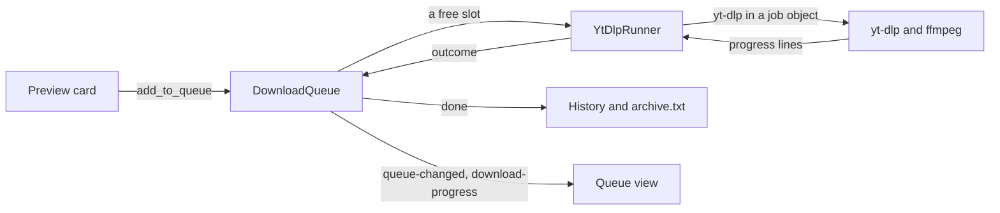
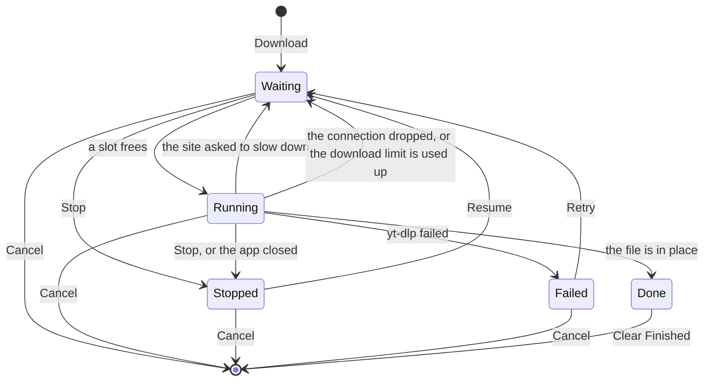

# Download Pipeline

> [!abstract]
> How a video goes from the preview card's Download to a file in its folder and a row in the history: the queue, the yt-dlp process and its arguments, progress, temporary folders, and what Stop, Resume, Cancel and Retry do. The code is in `tsundoku/core/src/downloads/`.

## Overview



1. Download on the preview card adds the video to the queue with a copy of the preset, so editing the preset later doesn't change it. A video can't be in the queue twice until it's done.
2. The queue starts waiting items while fewer than `downloads.atOnce` (2) run, in the queue's order: the order they were added, apart from those Download Next moved to the front. A post on a paced site (Instagram, and X, Pixiv or Tumblr once Settings → Pacing gives them a pause: `DownloadSettings::pause_for`) waits while another post of the same site runs, since each pauses between its files on its own; items behind it from other sites start meanwhile.
3. Each run is a thread running yt-dlp to its end. Its progress reaches the UI as events; its output goes to the item's log.
4. When yt-dlp finishes, the file is recorded in the history (a `videos` row if it's new, and a `downloads` row) and `archive.txt` is rewritten. The item is Done.

## From a Channel, Playlist or Account

A channel, playlist or account isn't downloaded as one: the preview card lists it (`core/src/listing.rs`), and Download Selected queues each ticked item as its own item, as if its link had been pasted.

1. `listing::listing_link` tells a listing from its address and gives the page to read: a YouTube channel's Videos tab (`/@name/videos`, whatever tab the link opened), a YouTube playlist (`/playlist?list=…`), an Instagram account's posts (`/name/posts/`). Anything else is read as one video or post; if yt-dlp answers it with a playlist anyway (another site's), it's listed when every entry has a link, a site and an ID of its own, and refused as `NotListable` otherwise.
2. `listing::read` lists it without reading each item: yt-dlp with the preview's own arguments (`--flat-playlist --dump-single-json`, cookies, caches) plus `--extractor-args youtubetab:approximate_date` (YouTube's listings say "3 weeks ago": yt-dlp turns that into a rough timestamp, kept apart from `upload_date` as `approximate_date`) and, for a channel, `--playlist-end 50`; gallery-dl with `--dump-json --post-range 1-50` for an account, whose posts are sorted newest first, pinned ones included. A listing may take up to 5 minutes, against 2 for a preview. Its errors are a preview's, so a missing sign-in offers the same fixes.
3. Each item is a `VideoInfo` keyed as reading its own link would key it (yt-dlp's `ie_key` and `id`, gallery-dl's post shortcode), so `listing::mark` finds it in the history (`last_download`) and the queue (`contains`) as the duplicate check does.
4. Download Selected sends a `QueuePick` per ticked item to `DownloadQueue::add_many`: a video with the preset a rule picks for it or else Videos Start As, and `overwrite` when it was downloaded before with that preset (the UI asks first); a post without one. `add_many` saves them all, then schedules once, so the UI gets one `queue-changed` for the batch. From there each is an ordinary item: rules pick its folder, Instagram's posts are paced, and a finished one goes to the history and `archive.txt`.

Downloads don't pass `--download-archive`, which would make Download Again skip a video it has. A pending link that's a listing is refused as `Playlist` before any tool runs.

## States



- The queue is saved in `tsundoku.db` (`queue_items`). An item that was running when the app closed or crashed comes back Stopped; waiting ones start again.
- Stop and Cancel both end the process (the whole job object, ffmpeg included). The run's thread then settles the item: Stop leaves it Stopped with its partial files; Cancel deletes its temporary folder and removes it.
- Retry and Resume put the item back in line. yt-dlp continues `.part` files by default, so neither starts over.
- Pause All, Resume All and Retry Failed (`stop_all`, `resume_all`, `retry_failed`) do Stop, Resume and Retry for every item in the state each acts on, through the same code as the single-item actions. Pause All holds the waiting items before it ends the running ones, so none starts in between, and leaves an item being cancelled to its cancel.
- Download Next (`download_next`) moves a waiting item to the front. `queue_items.position` is 0 for a new item and one less than the lowest for a moved one; the queue loads and starts by position, then ID, so the order holds through a restart.

## The Run

The downloads started since the queue was last idle make up its run (`downloads::run::QueueRun`), which the app crate's `queue_status.rs` follows through the queue listener to fill the taskbar button and write the tray icon's tooltip.

- An item waiting or running joins the run; when there's none, that starts one. Items added or resumed meanwhile join it.
- An item removed from the queue leaves the run, unless it was done (Clear Finished), which still counts. A cancelled one doesn't.
- The run ends once none of its items is waiting, running or stopped. `QueueRun::update` then answers `RunEvent::Ended` with how many finished and failed, as it answers `RunEvent::Failed` with the title each time one of its items fails (again if a retried one fails again); these become the notifications for failed and finished downloads (`downloads::notices`).
- Its progress is by bytes when every item's size is known (a file host's link from the start, a single file once it downloads, any download once done), otherwise the average of each item's share. Done and failed items count as whole, waiting ones as nothing. yt-dlp reports a fraction per file, so a video downloaded as two files counts its video file as 90% and its audio as the rest; merging and converting keep what the download reached.
- The taskbar is red (`Error`) once an item failed, yellow (`Paused`) while every item left is stopped, an indeterminate bar while nothing is known yet, and cleared once the run ends. Progress alone updates it at most every 250 ms; changes update it at once. Both are applied on the main thread, which the tray's setters wait for.

## When a Site Asks to Slow Down

- A run that fails because its site answered "too many requests" (HTTP 429, `PreviewError::TooManyRequests`) goes back to Waiting with its partial files, instead of Failed. Its site (`sites::site_of`) then waits: 5 minutes, doubled for each 429 in a row, up to an hour, and back to 5 once something from the site works (`site_limits`).
- While it waits, none of the site's downloads start, Pending doesn't read its links and the preview card refuses them; other sites go on. Each waiting item carries its `Hold` (`slowDown`, or `hourlyLimit` when Settings → Instagram's hourly limit on Instagram's files is reached), worked out whenever the queue schedules, and a thread schedules again once one ends.
- Neither tool passes on the site's Retry-After, so the waits are Tsundoku's own. They live in memory: after a restart, a waiting download tries once more.

## When a Download Fails

- A run that fails because the connection dropped (`PreviewError::Network`) goes back to Waiting with its partial files and is tried again after 30 seconds, 2 minutes and 8 minutes (`CONNECTION_RETRY_WAITS`); the fourth failure in a row leaves it Failed.
- A run that finds a file host's download limit used up (`PreviewError::LimitReached`: MEGA's transfer quota, a Google Drive or Dropbox file's) waits 30 minutes, doubled each time it's still used up, up to 4 hours, and never fails for it.
- Its `Hold` (`retry` or `limitReached`) says when; Try Now ends the wait. A finished run, Resume and Retry start the count over. Like the site waits, these live in memory: after a restart, a waiting download tries again at once.

## Room on the Drive

- As the queue is about to start a waiting download, it checks the download's drive has room for it (`downloads/room_check.rs`): what it's expected to take (`room::expected_bytes`), with a margin of 100 MB and 5%, against the drive's free space less what the downloads already running there still need.
- What it takes is known for a file host's link (its files' size) and, for a video, estimated from the sizes yt-dlp gave for its formats when its link was read, for those its preset picks. A post, a video read before Tsundoku started or one without sizes isn't checked.
- One that won't fit stays Waiting with `Hold::NotEnoughRoom`, and the next waiting download is tried. It's checked again 30 seconds later (`until`) and whenever the queue schedules (a download ends, is removed, retried or resumed), and starts once there's room.

## Arguments

`runner.rs` builds the command, Tsundoku's arguments first so the preset's can change them:

| Arguments | Why |
| --- | --- |
| `--ignore-config --no-playlist` | A user's yt-dlp config can't interfere; a `watch?v=…&list=…` link downloads only the video |
| `--encoding utf-8 --newline --progress --progress-delta 0.5` | Readable output, one progress line at most every half second |
| `--progress-template download:…` and `postprocess:…` | Progress as JSON lines Tsundoku can read (see Progress) |
| `--print-to-file after_move:%(.{filepath,height,vcodec,acodec,ext})j <file>` | The final path and format, once the file is in place |
| `-P home:<folder> -P temp:<folder>\.tsundoku-<id>` | Where the file goes, and where yt-dlp works |
| `--ffmpeg-location`, `--js-runtimes deno:<path>` (or `--no-js-runtimes`) | Tsundoku's tools |
| `--force-overwrites` | Only for Download Again with the same preset, after the user confirms |
| The preset's (`Preset::to_args`) | Formats, conversion, file name, embedding, SponsorBlock, extra arguments |
| `-- <link>` | After `--`, the link can't be read as an option |

`--print-to-file` rather than `--print`: `--print` turns yt-dlp quiet, and its normal output is what the log keeps. `after_move` still reports the path when yt-dlp finds the file already there and skips the download, so such a file is recorded too.

### Presets

| Preset | Formats |
| --- | --- |
| Best Video | `-f bv*+ba/b --merge-output-format mkv --remux-video mkv` |
| 1080p MP4 | `-f bv*+ba/b -S res:1080,vcodec:h264,acodec:aac --merge-output-format mp4 --remux-video mp4` |
| Best Audio | `-f ba/b -x` |
| Audio MP3 | `-f ba/b -x --audio-format mp3 --audio-quality 0` |

> [!info]
> MP4 presets sort for H.264 and AAC rather than for MP4 files: YouTube also serves AV1 in MP4, which older devices can't play. Sorting by height first keeps the tallest video within the limit; the codec only decides between formats of that height.

Extra arguments that would break what Tsundoku relies on are refused when the preset is saved (`--yes-playlist`, `--download-archive`, `--print`, `--progress-template`, `-o`, `-P`, `--quiet` and a few more), abbreviations included, since yt-dlp accepts `--outp` for `--output`.

## Progress

yt-dlp prints a line starting with `@@tsundoku` and a space for every progress update; everything else goes to the log.

```text
@@tsundoku {"stage":"download","progress":{"status":"downloading","downloaded_bytes":1024,"total_bytes":223779,...},"vcodec":"av01.0.00M.08","acodec":"none"}
@@tsundoku {"stage":"postprocess","progress":{"status":"started","postprocessor":"Merger"}}
```

- Download lines carry the format's codecs: no video codec means Downloading Audio, no audio codec Downloading Video, both a single-file Downloading. Some sites (archive.org) give no codec, which reads as Downloading.
- Postprocessor names map to stages: Merger → Merging; ExtractAudio, VideoConvertor and VideoRemuxer → Converting; Metadata, EmbedThumbnail and EmbedSubtitle → Embedding; MoveFiles → Finishing; anything else → Processing.
- Only the fields Tsundoku reads are printed (`%(progress.{…})j`), so each line stays short.

## Posts

A post of images (`video.post` set) is downloaded by gallery-dl instead, in `post_runner.rs`:

| Arguments | Why |
| --- | --- |
| `--config-ignore` | A user's gallery-dl config can't interfere |
| `-o output.mode=pipe`, `-o output.stdout={"encoding": "utf-8", "line_buffering": true}` | One line per file saved (or `# ` and its path for one already there), in UTF-8, as it's saved: the progress and the files to record |
| `-o downloader.part-directory=<folder>\.tsundoku-<id>` | Partial files in the item's temporary folder |
| `--directory <folder>` | Exactly the item's folder, without gallery-dl's own subfolders |
| `--filename <format>` | Settings → Posts of Images' name, as `post_names::gallery_format` writes it: `{username\|'natgeo'} 2026-11-04 DfPQchkG1tg {num\|filename}.{extension}` |
| `--range 1,3,6` | Only when some files were unticked (`VideoInfo::picked_post_files`): the files picked, by their place in the post, which the preview listed in the same order. Each keeps its `num`, so its name keeps its place |
| `--cookies-from-browser`, `--limit-rate` | As for a video |
| `--sleep <min>-<max>`, `--sleep-request <min>-<max>` | On a paced site (Instagram), before each file and between the requests that find them |
| `--no-skip` | Only for an item that replaces its files (`overwrite`), which a post never is: files already there are skipped, so downloading a post again only fetches what's missing |
| `-- <link>` | After `--`, the link can't be read as an option |

## File Hosts

File host downloads (MEGA, MediaFire, Google Drive, Dropbox, OneDrive, pCloud, WeTransfer) don't run a tool: `file_runner.rs` reads the link again (`core::hosts`), then fetches each file over HTTPS into `<n>.part` in the item's temporary folder. A part file resumes with a `Range` request, MEGA's decrypted from where it stopped. Each file is checked when it's complete (MEGA's MAC, MediaFire's SHA-256, OneDrive's SHA-1); a damaged one is deleted and the item fails with `damaged`, so Retry downloads it again. Google Drive and Dropbox give no checksum, so their files are checked by size, and an answer that isn't the file (such as Google Drive's download limit page) fails the item before anything is written. Its progress is the bytes of all the share's files, with the speed limit applied by sleeping between reads, and its log names each file and its size (MEGA's key is never written).

### A Check Only a Person Can Pass

- A file whose page Cloudflare answers with its check for a browser (MediaFire sends some files' pages there) is left for later while the share's other files download (`hosts::check`). The run then ends as `NeedsCheck`, and the item waits with `Hold::BrowserCheck`, which never ends by itself and never fails.
- Open Check shows those files' pages in the check window, one after another (`src-tauri/src/check_window.rs`). The person does what the check asks and starts the download on the page; the window catches its address as the page goes to it, so the WebView never fetches the file, and the item keeps the addresses (`caught_links`) and starts. The next run downloads those files from them, as a link copied from the Download button would be; files already in the folder are skipped.
- An address that has run out by then sends the run back to the page, which may ask again. Resume and Retry try afresh. Like the other holds, it lives in memory: after a restart, the run finds the check again.

## Temporary Folders

- Each item works in `<destination>\.tsundoku-<id>\`: on the same drive as the destination, so yt-dlp's final move is a rename, not a copy of a large file. The ID never repeats (`AUTOINCREMENT`).
- Stop keeps the folder, so Resume continues; Cancel deletes it; success deletes it once the file has moved out.
- A folder that can't be deleted (a file open in another app) is left behind rather than failing the download.

## Processes

Every yt-dlp run goes through `core::process`: no console window, started suspended, put in a job object that kills everything in it when its handle closes, then resumed. Ending the job ends yt-dlp and the ffmpeg it started, so cancelling during a merge leaves nothing running and nothing locking the file, and closing or crashing the app does the same.

## Logs

- `logs\<id>.log` in the data folder: a line with the time and the full command, then yt-dlp's output, for each run of the item (Resume and Retry append).
- Show Log shows its end under the row (`LogPanel`, `DownloadQueue::log`: at most 256 KiB, from the first whole line, through `bug_report::read_end`), read again every second while the download runs; its Open in Editor opens the file in the default text editor. Logs older than 30 days are deleted when the app starts.

## Events

| Event | Payload | Sent when |
| --- | --- | --- |
| `queue-changed` | Every `QueueItem` | An item is added, removed or changes state |
| `download-progress` | `DownloadProgressEvent` (`id`, `progress`) | yt-dlp reports progress |

The UI replaces its queue with each `queue-changed`, and keeps progress apart in a live store (`queueEvents.ts`), since it changes several times a second.
