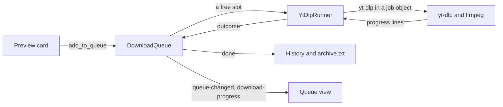
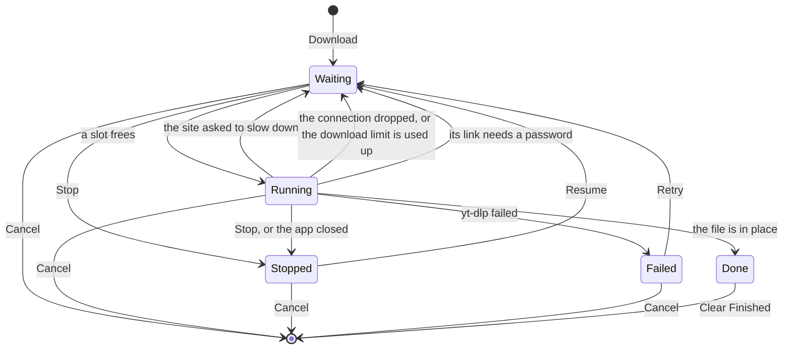

# Download Pipeline

> [!abstract]
> How a video goes from the preview card's Download to a file in its folder and a row in the history: the queue, the yt-dlp process and its arguments, progress, temporary folders, and what Stop, Resume, Cancel and Retry do. The code is in `tsundoku/core/src/downloads/`.

## Overview



1. Download on the preview card adds the video to the queue with a copy of the preset, so editing the preset later doesn't change it. A video can't be in the queue twice until it's done. Links also come in through Pending (`core::pending`), which reads each as the preview card does and starts it into the queue the same way: several pasted at once, copied ones (the clipboard watcher), sent ones (the clipboard shortcut, the browser bookmark, the send buttons), files of links dropped on the window, and links a page's Click'n'Load button sends (`core::click_n_load`, received on this PC's own address only, which never start by themselves).
2. The queue starts waiting items while fewer than `downloads.atOnce` (2) run, in the queue's order: the order they were added, apart from those Download Next moved to the front. A download from a paced site (Instagram, X, Pixiv, Tumblr: `sites::paced_site`) waits while as many of that site's downloads run as Settings → Pacing lets it have at once (`SitePace.at_once`, one to start with), since each pauses between its files on its own (`DownloadSettings::pause_for`, gallery-dl's `--sleep`): each slot has its own pause. Items behind it from other sites start meanwhile.
3. Each run is a thread running yt-dlp to its end. Its progress reaches the UI as events; its output goes to the item's log.
4. When yt-dlp finishes, the file is recorded in the history (a `videos` row if it's new, and a `downloads` row) and `archive.txt` is rewritten. The item is Done.

## From a Channel, Playlist or Account

A channel, playlist or account isn't downloaded as one: the preview card lists it (`core/src/listing.rs`), and Download Selected queues each ticked item as its own item, as if its link had been pasted.

1. `listing::listing_link` tells a listing from its address and gives the page to read: a YouTube channel's Videos tab (`/@name/videos`, whatever tab the link opened), a YouTube playlist (`/playlist?list=…`), an Instagram account's posts (`/name/posts/`), an X account's Media tab (`x.com/name/media`, from the profile or its Replies or Highlights tab, on x.com or twitter.com). Anything else is read as one video or post; if yt-dlp answers it with a playlist anyway (another site's), it's listed when every entry has a link, a site and an ID of its own, and refused as `NotListable` otherwise.
2. `listing::read` lists it without reading each item: yt-dlp with the preview's own arguments (`--flat-playlist --dump-single-json`, cookies, caches) plus `--extractor-args youtubetab:approximate_date` (YouTube's listings say "3 weeks ago": yt-dlp turns that into a rough timestamp, kept apart from `upload_date` as `approximate_date`) and, for a channel, `--playlist-end 50`; gallery-dl with `--dump-json --post-range 1-50` for an account, whose posts are sorted newest first, pinned ones included. A listing may take up to 5 minutes, against 2 for a preview. Its errors are a preview's, so a missing sign-in offers the same fixes.
3. Each item is a `VideoInfo` keyed as reading its own link would key it (yt-dlp's `ie_key` and `id`, gallery-dl's post shortcode or tweet ID), with its own page as its link (Instagram's `post_url`; on X, whose answer has none, `x.com/<author>/status/<ID>`), so `listing::mark` finds it in the history (`last_download`) and the queue (`contains`) as the duplicate check does.
4. When the read answered as many as it asked for (50), `Listing.more` (`ListingMore`) says where the next items start: the page, the listing's title (which the next items take as their `playlist`), how many were `read`, on Instagram gallery-dl's `cursor` (the last `[…][debug] Cursor: …` line its `--verbose` log wrote, `gallery::last_cursor`), and on YouTube the channel's ID (`channel_id`). The picker's Load More, Load 50 New and Load All hand it back to `load_more_of_listing` with a `MoreRead` (`next`, `new {count}`, `all`; `PreviewService::fetch_more`, `listing::read_more`), which streams `MoreItems` batches over a Tauri `Channel`, each marked as above, until the end (`more` `None`), enough new ones for Load New (the batch callback answers how many of a batch the history and the queue don't have), or Stop (`cancel_loading_more`; a new preview stops it too):
   - **YouTube channel**: Load More reads `--playlist-items 51:100` (and so on) with `--dump-single-json`; Load New and Load All run yt-dlp once with `--lazy-playlist --dump-json --playlist-items 51:`, one JSON line per video (`metadata::run_entries`), handed over 100 at a time (`channel_rest`), or for Load New, once new ones came, as many at a time as are still wanted, and the run is stopped once there are enough. A line's `upload_date` is yt-dlp's day of the rough date, so it's dropped; its owner comes from `playlist_channel` and `playlist_uploader_id`.
   - **Instagram**: `-o cursor=<cursor>` starts on the page after the last one read whole, which may repeat a few posts (the UI keeps each once; `read_more` leaves out what it handed over already). Its pages are 12 posts. Load More asks for 48; Load All and Load New read 96 per run with 10 s between runs on top of gallery-dl's 6 to 12 s between pages, each run handed over as it ends, so Stop keeps them; once Load New has some new ones, its next run asks only for the whole pages still wanted (`whole_pages`). A cursor that didn't move falls back to `--post-range` from `read`.
   - **X**: `--post-range` from `read`, as 0.1.140 did: Load More `51-100` (and so on), Load New runs of 200 (then the whole pages of 50 still wanted), Load All one run of `--post-range 51-`, which Stop ends with nothing kept. X isn't read from a cursor because gallery-dl 1.32.20 reads its Media tab as photos then videos, and a cursor saved in the photos fails once they end (X answers "Dependency: Unspecified" and the run aborts); X allows reading the newer pages again without waits.
   - A 429 is a site wait, as for a preview: `fetch_more` refuses while one is on, and a wait that starts between runs ends Load New or Load All with what was read.
   - **Counts**: Load All shows how many the listing holds when that's known. Instagram's `media_count` says it with the first read. A YouTube channel's Videos tab gives no `playlist_count`, so the picker asks `count_listing` (`PreviewService::count_more`, own cancel slot; `listing::count_more`) once it opens: yt-dlp reads the channel's playlist of uploads that are videos, `UULF` plus the channel ID after `UC` (`videos_playlist`), with `--playlist-items 1`, whose `playlist_count` matched the tab's videos exactly on 3Blue1Brown (153) and NASA (5,561) on 2026-11-15 (the `UU` playlist of every upload counts Shorts and live streams too: 247 and 6,204). X's `media_count` matches neither the posts with pictures or videos nor their files (rustlang: 110 against 81 posts of 98 files), so X has no count until the end is reached.
   - **A watched source's check** (`listing::read_for_check`) only needs the items up to what it saw before, so an account's check first asks for what its site's first answer holds, less one (`Paging::check_first`), since gallery-dl only sees a range has ended at the post after it, and asking for that post fetches the next page. An Instagram account's check asks for `--post-range 1-11`: Instagram's first page holds 12, pinned posts first, and the next one comes after a 6 to 12 s wait. An X account's asks for `--post-range 1-19`: X answers 20 to 40 posts first for a Media tab (21, 26 and 39 seen) though 50 are asked, so the newest 50 take a second page or more, half a second to a second each, after the request for the account itself (2.3 to 3.5 s in all against 1.9 to 2.5 s for `1-19` on 2026-11-15). When `before_known_ground` doesn't reach known ground in those (8 or so new posts on Instagram, 16 or so on X) and the account has more, it reads the newest 50 as above (on Instagram 10 s later). A YouTube channel answers its newest 50 at once, so its check reads them as before.
5. Download Selected sends a `QueuePick` per ticked item to `DownloadQueue::add_many`, with the listing as their `QueueSource`, which each queue item keeps (`queue_items.source`) so the Queue shows them under the source's heading: a video with the preset a rule picks for it or else Videos Start As, and `overwrite` when it was downloaded before with that preset (the UI asks first); a post without one. `add_many` saves them all, then schedules once, so the UI gets one `queue-changed` for the batch. From there each is an ordinary item: rules pick its folder, Instagram's posts are paced, and a finished one goes to the history and `archive.txt`.

Downloads don't pass `--download-archive`, which would make Download Again skip a video it has. A pending link that's a listing is refused as `Playlist` before any tool runs, and waits in Pending as `NeedsPicking` (Needs Attention), which nothing starts, until it's picked from in the preview card.

## States



- The queue is saved in `tsundoku.db` (`queue_items`). An item that was running when the app closed or crashed comes back Stopped; waiting ones start again.
- Stop and Cancel both end the process (the whole job object, ffmpeg included). The run's thread then settles the item: Stop leaves it Stopped with its partial files; Cancel deletes its temporary folder and removes it.
- Retry and Resume put the item back in line. yt-dlp continues `.part` files by default, so neither starts over.
- Pause All, Resume All and Retry Failed (`stop_all`, `resume_all`, `retry_failed`) do Stop, Resume and Retry for every item in the state each acts on, through the same code as the single-item actions. Pause All holds the waiting items before it ends the running ones, so none starts in between, and leaves an item being cancelled to its cancel.
- Download Next (`download_next`) moves a waiting item to the front. `queue_items.position` is 0 for a new item and one less than the lowest for a moved one; the queue loads and starts by position, then ID, so the order holds through a restart.

## The Run

The downloads started since the queue was last idle make up its run (`downloads::run::QueueRun`), which the app crate's `queue_status.rs` follows through the queue listener to fill the taskbar button and write the tray icon's tooltip.

- An item waiting or running joins the run; when there's none, that starts one. Items added or resumed meanwhile join it.
- An item removed from the queue leaves the run, unless it was done (Clear Finished), which still counts. A cancelled one doesn't.
- The run ends once none of its items is waiting, running or stopped. `QueueRun::update` then answers `RunEvent::Ended` with how many finished and failed, as it answers `RunEvent::Failed` with the title each time one of its items fails (again if a retried one fails again); these become the notifications for failed and finished downloads (`downloads::notices`).
- Its progress is by bytes when every item's size is known (a file host's link from the start, a single file once it downloads, any download once done), otherwise the average of each item's share. Done and failed items count as whole, waiting ones as nothing. yt-dlp reports a fraction per file, so a video downloaded as two files counts its video file as 90% and its audio as the rest; merging and converting keep what the download reached.
- The taskbar is red (`Error`) once an item failed, yellow (`Paused`) while every item left is stopped, an indeterminate bar while nothing is known yet, and cleared once the run ends. Progress alone updates it at most every 250 ms; changes update it at once. Both are applied on the main thread, which the tray's setters wait for.

## When a Site Asks to Slow Down

- A run that fails because its site answered "too many requests" (HTTP 429, `PreviewError::TooManyRequests`) goes back to Waiting with its partial files, instead of Failed. Its site (`sites::site_of`) then waits: 5 minutes, doubled for each 429 in a row, up to an hour, and back to 5 once something from the site works (`site_limits`).
- While it waits, none of the site's downloads start, Pending doesn't read its links and the preview card refuses them; other sites go on. Each waiting item carries its `Hold` (`slowDown`, or `hourlyLimit` when Settings → Instagram's hourly limit on Instagram's files is reached), worked out whenever the queue schedules, and a thread schedules again once one ends.
- Neither tool passes on the site's Retry-After, so the waits are Tsundoku's own. They live in memory: after a restart, a waiting download tries once more.

## When a Download Fails

- A run that fails because the connection dropped (`PreviewError::Network`) goes back to Waiting with its partial files and is tried again after 30 seconds, 2 minutes and 8 minutes (`CONNECTION_RETRY_WAITS`); the fourth failure in a row leaves it Failed.
- A run that finds a file host's download limit used up (`PreviewError::LimitReached`: MEGA's transfer quota, a Google Drive or Dropbox file's) waits 30 minutes, doubled each time it's still used up, up to 4 hours, and never fails for it.
- Its `Hold` (`retry` or `limitReached`) says when; Try Now ends the wait. A finished run, Resume and Retry start the count over. Like the site waits, these live in memory: after a restart, a waiting download tries again at once.

## Room on the Drive

- As the queue is about to start a waiting download, it checks the download's drive has room for it (`downloads/room_check.rs`): what it's expected to take (`room::expected_bytes`), with a margin of 100 MB and 5%, against the drive's free space less what the downloads already running there still need.
- What it takes is known for a file host's link (its files' size) and, for a video, estimated from the sizes yt-dlp gave for its formats when its link was read, for those its preset picks. A post, a video read before Tsundoku started or one without sizes isn't checked.
- One that won't fit stays Waiting with `Hold::NotEnoughRoom`, and the next waiting download is tried. It's checked again 30 seconds later (`until`) and whenever the queue schedules (a download ends, is removed, retried or resumed), and starts once there's room.

## Unpacking Archives

With Settings → Archives' Unpack Archives After Downloading on (`UnpackSettings`, on to start with), or a rule saying to for the download (`FolderRule.unpack`, which also turns it off for the downloads it matches), `ToolRunner::run` passes a run that finished, whichever runner made it (yt-dlp, gallery-dl or a file host), to `downloads/unpacking.rs`, which unpacks the archives among its files with `core::unpack`. `DownloadQueue::unpack_job` decides when the run starts (`JobSpec.unpack`): the rule picked for the item, else the last rule that's on, says and matches (`rules::unpacking_rule`), else Settings; the passwords and what becomes of the archive are Settings'.

- **Which files are archives** (`unpack::sets_among`, `unpack/sets.rs`): by name, `.zip`, `.7z` and `.rar` in one file, `.part1.rar` (any number of digits), `.rar` with `.r00`…`.r99` then `.s00` (rar's older naming), and `.7z.001` or `.zip.001` pieces, which are joined back as they are (`unpack/joined.rs`). A zip spanned over `.z01` files is `Completeness::Unsupported` and left as it is. A file whose name says nothing is never opened to find out.
- **Parts from several downloads**: a set's parts are looked for in its folder, not only among the run's files, so the download that brings the last part unpacks it; until then a set missing a part its names tell of is left as it is (`Completeness::Missing`), with a line in the log. Two downloads finishing parts of one set at once don't both unpack it: `unpack::claim` holds its first part's path while one does.
- **The readers**: zip with the `zip` crate (Deflate, Deflate64, bzip2, LZMA, XZ, PPMd, ZipCrypto and AES), 7z with `sevenz-rust2` (LZMA, LZMA2, bzip2, Deflate, PPMd, AES with the names hidden or not), rar 3 to 5 with RARLAB's UnRAR library (`unrar_sys`, built from its C++ source), driven through its callback in `unpack/rar.rs`: a part it asks for that isn't there is `MissingPart`, the password is given when it asks, and the data is written as it comes (`RAR_TEST` with `UCM_PROCESSDATA`), so every entry goes through the same checks. UnRAR is one archive at a time (`ONE_AT_A_TIME`), since it isn't known to be safe on several threads.
- **Passwords**: each archive is tried without one, then with each of the list's in order, until one opens it. A reader that can't tell a wrong password from damage (ZipCrypto, rar 4's data) counts damage under a password as a wrong one. With none left, `UnpackProblem::NeedsPassword` (the list was empty) or `WrongPassword { tried }`. The log says which one opened it by its place in the list, never the password.
- **Where it goes**: what the directory lists is checked against the drive's free space (`room::shortfall`, the same margin as the queue's check), then unpacked into `<temporary folder>\unpacking`, on the archive's drive. Entries whose names go up out of that folder (`..`) and links are left out (`left_out`, logged); a name starting at a root stays inside it, and names Windows refuses are made safe (`files::safe_relative`: `CON` → `_CON`, `?` and `:` → `_`). Then it's put beside the archive as `UnpackPlace` says (Settings → Archives' Where to Unpack, or the rule's): `Smart` moves one file or folder at its top beside the archive as it is and puts several in a folder named after the archive's stem, `ArchiveFolder` always puts them in that folder, `InPlace` moves each thing at its top beside the archive as it is (folders first, then files, each by name; should one fail to move, those moved go back so nothing is left half-placed). A name already taken gets " (2)", " (3)"… Progress is the bytes written of the listed size, as the stage Unpacking.
- **After**: the archive's parts move to the Recycle Bin (`SHFileOperationW` with `FOF_ALLOWUNDO`), are deleted, or kept (`AfterUnpacking`). One that can't be moved or deleted stays, with a line in the log. The run's files, as the History records them, are what each archive held in place of its first part, then the parts kept and those of sets left as they are.
- **When one isn't unpacked**: the run ends as `JobOutcome::NotUnpacked`, with every file kept and the item's `unpack_files` set: the files already settled and the archives still to unpack. One that failed is Failed with `DownloadError::Unpack { archive, problem }` (the first problem; the others are still tried); one stopped while unpacking is Stopped, what it had unpacked removed. Retry and Resume then send `JobSpec::unpack_only`, which only unpacks, while its archives are all still there; otherwise, and after a restart (`unpack_files` lives in memory), the item downloads again and finds its files already there. Changing an item's folder clears it. With unpacking turned off meanwhile, an unpack-only run finishes with the files as they are.
- Tests: `unpack/tests.rs` makes zip and 7z archives itself (with AES, hidden names and pieces) and unpacks the real rar parts in `core/tests/fixtures/archives` (rar 5 parts, rar 3's older naming, passwords on names and data, a missing part), whose `README.md` says where each comes from; `downloads/unpacking.rs` tests the order of the files, kept parts, a part waiting for the rest, and a failure kept for Retry.

## Arguments

`runner.rs` builds the command, Tsundoku's arguments first so the preset's can change them:

| Arguments | Why |
| --- | --- |
| `--ignore-config --no-playlist` | A user's yt-dlp config can't interfere; a `watch?v=…&list=…` link downloads only the video |
| `--encoding utf-8 --newline --progress --progress-delta 0.5` | Readable output, one progress line at most every half second |
| `--progress-template download:…` and `postprocess:…` | Progress as JSON lines Tsundoku can read (see Progress) |
| `--print-to-file after_move:%(.{filepath,height,vcodec,acodec,ext})j <file>` | The final path and format, once the file is in place |
| `-P home:<folder> -P temp:<folder>\.tsundoku-<id>` | Where the file goes, and where yt-dlp works |
| `--ffmpeg-location`, `--js-runtimes deno:<path>` (or `--no-js-runtimes`) | Tsundoku's tools |
| `--force-overwrites` | Only for Download Again with the same preset, after the user confirms |
| `--video-password <password>` | Only for a video whose link needs one; the log writes `<password>` instead |
| The preset's (`Preset::to_args`) | Formats, conversion, file name, embedding, SponsorBlock, extra arguments |
| `-- <link>` | After `--`, the link can't be read as an option |

`--print-to-file` rather than `--print`: `--print` turns yt-dlp quiet, and its normal output is what the log keeps. `after_move` still reports the path when yt-dlp finds the file already there and skips the download, so such a file is recorded too.

### Presets

| Preset | Formats |
| --- | --- |
| Best Video | `-f bv*+ba/b --merge-output-format mkv --remux-video mkv` |
| 1080p MP4 | `-f bv*+ba/b -S res:1080,vcodec:h264,acodec:aac --merge-output-format mp4 --remux-video mp4` |
| Best Audio | `-f ba/b -x` |
| Audio MP3 | `-f ba/b -x --audio-format mp3 --audio-quality 0` |

> [!info]
> MP4 presets sort for H.264 and AAC rather than for MP4 files: YouTube also serves AV1 in MP4, which older devices can't play. Sorting by height first keeps the tallest video within the limit; the codec only decides between formats of that height.

Extra arguments that would break what Tsundoku relies on are refused when the preset is saved (`--yes-playlist`, `--download-archive`, `--print`, `--progress-template`, `-o`, `-P`, `--quiet` and a few more), abbreviations included, since yt-dlp accepts `--outp` for `--output`.

## Progress

yt-dlp prints a line starting with `@@tsundoku` and a space for every progress update; everything else goes to the log.

```text
@@tsundoku {"stage":"download","progress":{"status":"downloading","downloaded_bytes":1024,"total_bytes":223779,...},"vcodec":"av01.0.00M.08","acodec":"none"}
@@tsundoku {"stage":"postprocess","progress":{"status":"started","postprocessor":"Merger"}}
```

- Download lines carry the format's codecs: no video codec means Downloading Audio, no audio codec Downloading Video, both a single-file Downloading. Some sites (archive.org) give no codec, which reads as Downloading.
- Postprocessor names map to stages: Merger → Merging; ExtractAudio, VideoConvertor and VideoRemuxer → Converting; Metadata, EmbedThumbnail and EmbedSubtitle → Embedding; MoveFiles → Finishing; anything else → Processing.
- Only the fields Tsundoku reads are printed (`%(progress.{…})j`), so each line stays short.

## Posts

A post of images (`video.post` set) is downloaded by gallery-dl instead, in `post_runner.rs`:

| Arguments | Why |
| --- | --- |
| `--config-ignore` | A user's gallery-dl config can't interfere |
| `-o output.mode=pipe`, `-o output.stdout={"encoding": "utf-8", "line_buffering": true}` | One line per file saved (or `# ` and its path for one already there), in UTF-8, as it's saved: the progress and the files to record |
| `-o downloader.part-directory=<folder>\.tsundoku-<id>` | Partial files in the item's temporary folder |
| `--directory <folder>` | Exactly the item's folder, without gallery-dl's own subfolders |
| `--filename <format>` | Settings → Posts of Images' name, as `post_names::gallery_format` writes it: `{username\|'natgeo'} 2026-11-04 DfPQchkG1tg {num\|filename}.{extension}` |
| `--range 1,3,6` | Only when some files were unticked (`VideoInfo::picked_post_files`): the files picked, by their place in the post, which the preview listed in the same order. Each keeps its `num`, so its name keeps its place |
| `--cookies-from-browser`, `--limit-rate` | As for a video |
| `--sleep <min>-<max>`, `--sleep-request <min>-<max>` | On a paced site (Instagram), before each file and between the requests that find them |
| `--no-skip` | Only for an item that replaces its files (`overwrite`), which a post never is: files already there are skipped, so downloading a post again only fetches what's missing |
| `-- <link>` | After `--`, the link can't be read as an option |

## File Hosts

File host downloads (MEGA, MediaFire, Google Drive, Dropbox, OneDrive, pCloud, WeTransfer, the Internet Archive, Yandex Disk, Box, Icedrive, 1fichier, SwissTransfer, Files.fm, upload.ee, TransferNow, Filemail, Workupload, Buzzheavier) don't run a tool: `file_runner.rs` reads the link again (`core::hosts`), waits out a host's countdown before a free download where there is one (1fichier's, shown as Counting Down with the time left; a host that says to wait between downloads holds the item until then instead), then fetches each file over HTTPS into `<n>.part` in the item's temporary folder. A part file resumes with a `Range` request, MEGA's decrypted from where it stopped. Each file is checked when it's complete (MEGA's MAC, MediaFire's SHA-256, OneDrive's SHA-1, Filemail's MD5); a damaged one is deleted and the item fails with `damaged`, so Retry downloads it again. Google Drive and Dropbox give no checksum, so their files are checked by size, and an answer that isn't the file (such as Google Drive's download limit page) fails the item before anything is written. Its progress is the bytes of all the share's files, with the speed limit applied by sleeping between reads, and its log names each file and its size (MEGA's key is never written).

A shared folder whose files were picked (`VideoInfo.shared_files`, some unticked) carries the paths of those picked as `JobSpec.picked_files` (`VideoInfo::picked_shared_files`; `None` for the whole folder). The run reads the folder again and takes only the files whose path (`hosts::shared_path`: the folders and the name joined with "/") was picked (`taken_files`), two files of one path together; each keeps its place in the whole share for its `<n>.part`, so a stopped download continues the right part file whatever was picked since. The progress, Finishing and the log's first line ("340 files, … bytes; 12 picked, … bytes") go by the files picked, as do the room the download needs (`room::expected_bytes`, through `VideoInfo::picked_contents`) and its share of the run's progress. A picked path the folder no longer has is written to the log and skipped; when none is left, the item fails with `pickedFilesGone` instead of downloading the rest. The run answers the paths in the share of the files it took (`JobOutcome::Finished.shared`), which unpacking carries through when the archives are replaced by what they held, and which the history keeps on the download (`downloads.share_paths`), so a folder downloaded again knows which files no download took (`History::left_out_shared_files`).

### A Check Only a Person Can Pass

- Every request a host's reader or a download sends goes through one step that knows the checking service's markers (`hosts::checked`: Cloudflare's `cf-mitigated: challenge`, or its "Just a moment..." page on a 403 or 503), so every site meets a check the same way. Nothing about a site's pages is involved.
- A link whose own page is behind a check, or a link from a site read only through the check window (Workupload, Buzzheavier: `hosts::window_sites`), reads as one file named after the link, its size unknown. A file whose address or download meets a check is left for later while the share's other files download, when it has a page a person can open (MediaFire's and Yandex Disk's file pages, the link's own for a share of one file). The run then ends as `NeedsCheck`, and the item waits with `Hold::BrowserCheck`, which never ends by itself and never fails.
- Open Check shows those files' pages in the check window, one after another (`src-tauri/src/check_window.rs`). The person does what the check asks and starts the download on the page. The window takes the first download whose address is on the link's site, from the page, one of its frames or a window it opened (others are stopped), holds it, and offers it to the item (`DownloadQueue::offer_window_download`), which starts at once.
- The item's run asks that address itself, as every download is asked (`file_runner::open_file`). When the answer is strictly the file (a success that isn't a page, its size the one the window saw), the window stops its own download and the run downloads the file with its progress, keeping the address for its next runs (`caught_links`). Otherwise, or when no run takes the offer within 20 seconds, the window saves the file itself into the item's temporary folder and hides; the row shows that download's progress (`Hold::WindowDownload`), and the next run moves the file into place. Stop or Remove stops either; closing the window before the window saves anything puts the item back to waiting for its check.
- An address that has run out by then sends the run back to the page, which may ask again. Resume and Retry try afresh. Like the other holds, it lives in memory: after a restart, the run finds the check again.

## When a Link Needs a Password

- A run whose link needs a password it doesn't have, or whose password didn't open it (`PreviewError::PasswordNeeded`), goes back to Waiting with `Hold::NeedsPassword` instead of Failed (`wrong` when it had one, which is dropped). Like a check, it never ends by itself and never retries.
- Enter Password (`DownloadQueue::enter_password`) keeps the password with the item (`queue_items.password`) and starts it. A run gives it beside the link: to a file host's reader (`Host::read`) or to yt-dlp as `--video-password`, never inside the link.
- A finished download's password goes to the history (`videos.password`), and a new download of the same video, or a link the history has, opens with it, so Retry and Download Again don't ask.
- The log writes the command with the password blanked (`<password>`), and Copy Details blanks it again.

## Temporary Folders

- Each item works in `<destination>\.tsundoku-<id>\`: on the same drive as the destination, so yt-dlp's final move is a rename, not a copy of a large file. The ID never repeats (`AUTOINCREMENT`).
- Stop keeps the folder, so Resume continues; Cancel deletes it; success deletes it once the file has moved out.
- Unpacking works in its `unpacking` folder, emptied before each archive and removed after.
- A folder that can't be deleted (a file open in another app) is left behind rather than failing the download.

## Processes

Every yt-dlp run goes through `core::process`: no console window, started suspended, put in a job object that kills everything in it when its handle closes, then resumed. Ending the job ends yt-dlp and the ffmpeg it started, so cancelling during a merge leaves nothing running and nothing locking the file, and closing or crashing the app does the same.

## Logs

- `logs\<id>.log` in the data folder: a line with the time and the full command, then yt-dlp's output, for each run of the item (Resume and Retry append). Unpacking adds a `=== <time> unpacking` line, then one line per archive: unpacked (how many files, their size, where, and which password from the list by number), left out, left as it is and why, or why it couldn't be unpacked, and what became of its parts.
- Show Log shows its end under the row (`LogPanel`, `DownloadQueue::log`: at most 256 KiB, from the first whole line, through `bug_report::read_end`), read again every second while the download runs; its Open in Editor opens the file in the default text editor. Logs older than 30 days are deleted when the app starts.

## Events

| Event | Payload | Sent when |
| --- | --- | --- |
| `queue-changed` | Every `QueueItem` | An item is added, removed or changes state |
| `download-progress` | `DownloadProgressEvent` (`id`, `progress`) | yt-dlp reports progress |

The UI replaces its queue with each `queue-changed`, and keeps progress apart in a live store (`queueEvents.ts`), since it changes several times a second.
